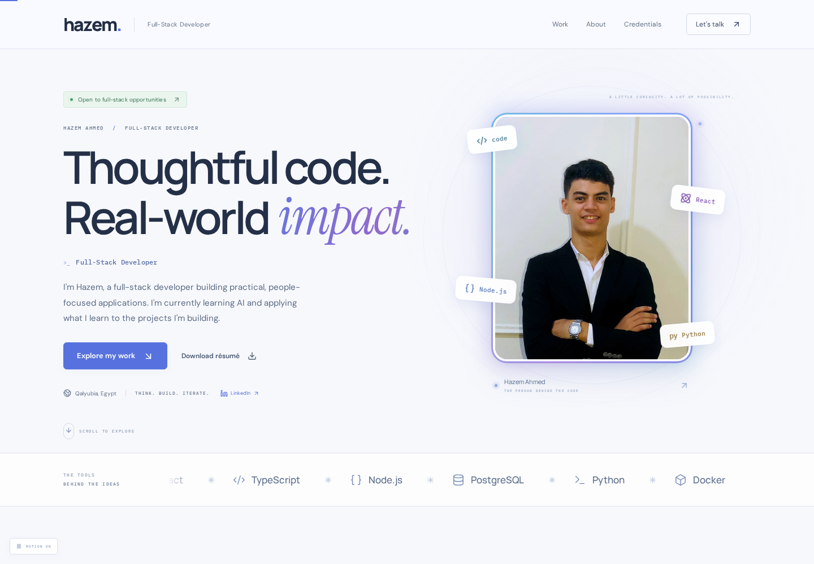

# Portfolio-hazem

Hazem Ahmed’s English-language full-stack developer portfolio: a light visual theme, original portrait, motion controls, selected work, training, résumé, email/telephone contact, and a password-protected content Studio.



## Stack

React + Vite + Motion; Express + SQLite. Fonts and portfolio images are hosted locally.

## Run

Requires Node.js 20.19+ (Node 22 LTS recommended).

```bash
npm ci
npm start
```

The server binds to `0.0.0.0:3000`; set `PORT` to change the port. Browser API calls use relative same-origin URLs.

## Studio and persistence

Open `/admin`. The initial username is `hazem`.

On the **first** start, a random password is written to the server’s private `private/ADMIN_ACCESS.md` file. It is not served by the website. Change it in Studio → Settings → Security. Alternatively, supply a strong `ADMIN_PASSWORD` through your hosting provider’s secret environment settings before the first initialization. It does not override an existing account.

- Portfolio content, users, sessions, and inquiries are stored in `data/portfolio.sqlite`.
- Public uploads are stored in `data/uploads/`.
- Set `DATA_DIR` to a persistent mounted directory when deploying.
- Keep a private, consistent backup of the complete data directory. Studio’s JSON export is a content-only backup.
- No live database, inbox, user/session data, account passwords, email credentials, GitHub tokens, or private test-account files are included in this repository.

This clean source snapshot seeds **only published portfolio content**. Unpublished local drafts are intentionally excluded. Hidden project repository URLs are omitted from the public seed, and the `showSource` setting remains disabled for CONFIT. This repository is not a backup of the owner’s private running Studio account.

## Contact and Gmail

The Contact section includes the owner’s public email and CV-sourced phone number with a `tel:` link. Contact form submissions are saved to Studio.

Gmail forwarding is optional and **inactive without owner configuration**. Configure a dedicated Google App Password privately in Studio → Settings → Gmail forwarding, or supply `GMAIL_USER` and `GMAIL_APP_PASSWORD` as hosting secrets. Never use a normal Google account password or put credentials into source control. See [the setup guide](docs/GMAIL_SETUP_AR.md).

## Deployment

**GitHub stores the source; GitHub Pages alone cannot run this full application.** Express APIs, SQLite persistence, Studio authentication, uploads, and Gmail forwarding require a Node.js host, persistent storage, HTTPS, and (for SMTP) outbound port 465 access.

Do not publish the `private/` or `data/` directories. Environment variables must be configured in the host environment; the application does not automatically load a `.env` file.

## Project and training presentation

- Madar uses an actual signed-in student-workspace capture from a synthetic review account. Its credentials are not published.
- CONFIT is shown as an e-commerce case study. Its source button is hidden at the owner’s request; the previously checked deployment is marked paused.
- Other project links distinguish public demos from sign-in-required applications.
- ITI, NTI, MCIT, and Africa Matters use the supplied provider marks. Logos are branding, not substitute certificate scans.

See [project and asset provenance](docs/PROVENANCE.md). Internal review notes and private account records are not part of this public snapshot.

## ZoomTech preview

`public/demos/zoomtech/index.html` is a labeled preview of the public Basics12 build, with embedded credentials removed and live AI disabled. Chat uses the project’s local curriculum fallback. The Node server enforces a dedicated opaque-origin sandbox and restricted Content Security Policy for this preview. **Preserve this response policy if changing hosting.** Do not treat this modified preview as the original production deployment.

Local read-only browser checks are provided under `scripts/`; they require a running local server and Playwright Chromium. No external account-creation or publication-credential helpers are included.

## Tests

```bash
npm test
```

Tests use temporary databases and a fake SMTP transport. They do not send real Gmail messages or create accounts on the showcased applications.

## Content and attribution

The owner chose to publish the portfolio’s profile, résumé, portrait, contact details, and project descriptions. Third-party provider logos, project captures, fonts, and dependencies retain their respective rights and attribution. No broader license for those assets is implied by making this source repository public.
